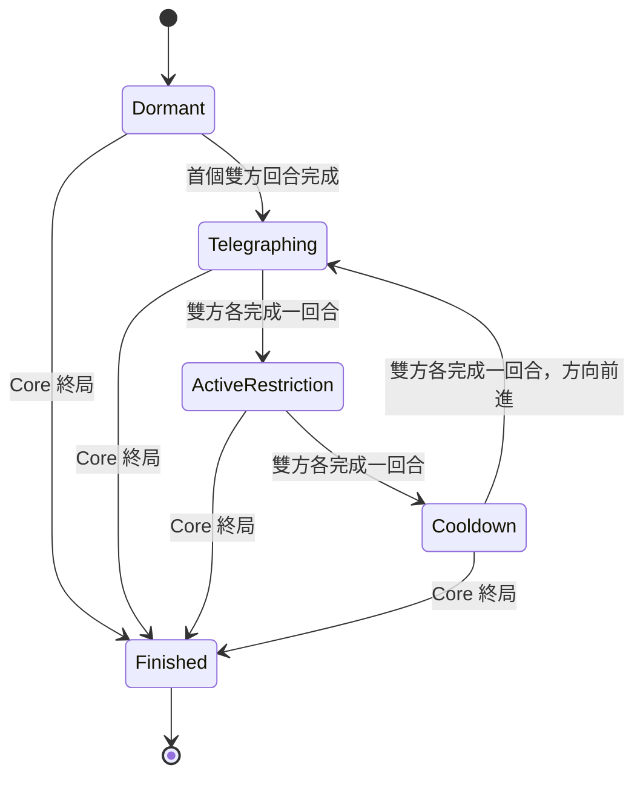

# BOSS-00｜成對回合狀態機

推薦狀態表；尚未採用。所有轉移由已提交的回合收據驅動，不能由動畫完成 callback、倒數秒數或 App 幀率觸發。

| Core ply | Phase | 行動量與環境 |
|---|---|---|
| 1 / 2 | Dormant | 先手 1 AP、後手 2 AP；不预告、不限制，避免不對稱開局受罰 |
| 3 / 4 | Telegraphing North | 雙方各 2 AP，D3/D2/D1 警告，仍可落子 |
| 5 / 6 | ActiveRestriction North | 雙方各 2 AP；射線空點禁止新放棋子，既有棋子不動 |
| 7 / 8 | Cooldown | 限制清除，方向索引準備 East；雙方各 2 AP |
| 9 / 10 | Telegraphing East | 下一條警告 E4/F4/G4，之後循環 |
| 11 / 12 | ActiveRestriction East | E4/F4/G4 禁止新放棋子，既有技能依原規則處理 |
| 13 / 14 | Cooldown | East 限制清除，下一輪準備 South |

提前 endTurn 與用盡 AP 都算一次已完成回合，不能用 Pass 跳過個人風險但保留對手限制。環境不額外消耗 AP/Mana，也不再生成 turnStarted；Core 仍是回合與資源的唯一來源。

在某玩家 action 終局時不執行當下環境轉移。Active 的存檔重啟仍 Active；背景待十小時也不推進。Undo 包括該玩家 action、其產生的環境轉移以及完整 Core history，一起按 journal 重播。需未來測試，但本輪未實作。

預告跨雙方各一次正常回合，環境只在成對回合結束啟用。單人玩家選黑/白不能變更 phase 規律。若未來想讓每次輪替都發作，必須重新審查先手公平性。
