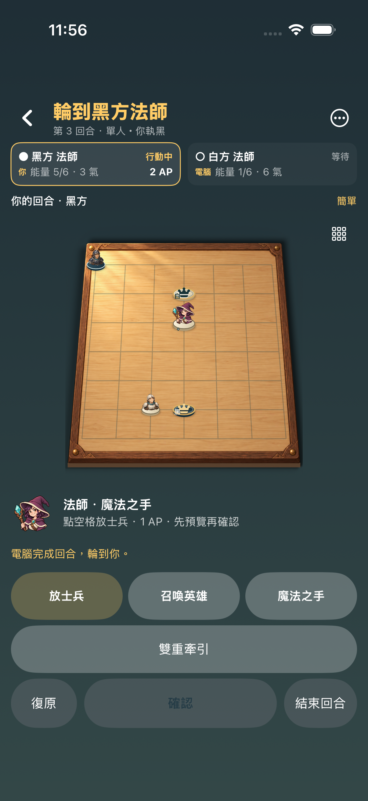
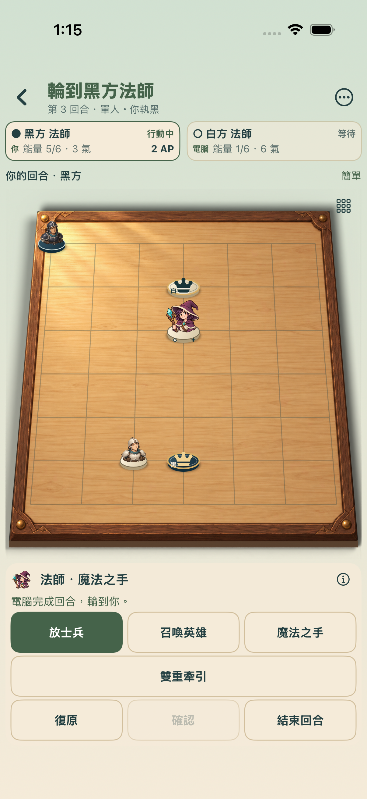
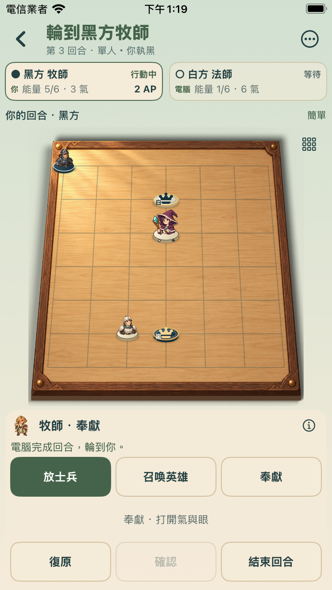
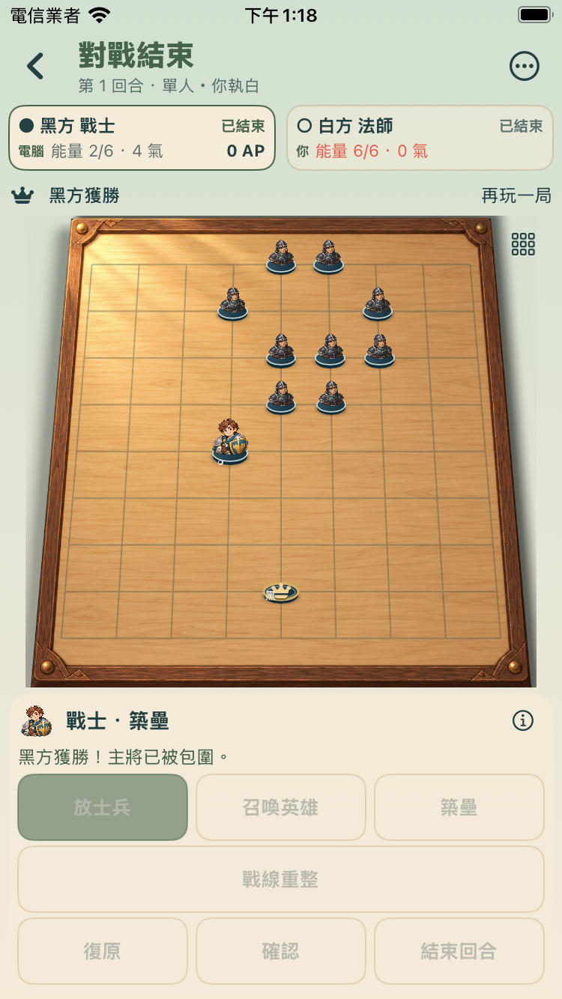

# 1.1 同一介面與固定棋盤（1106）

結果：1106已上傳TestFlight、Apple處理完成，Owner1.1群組可更新。
原因：1105仍保留深色大灰按鈕，7×7未用精簡控制區；職業、技能列與電腦訊息會重新分配棋盤空間。
下一步：TestFlight更新1.1（1106），新開電腦對戰，試7×7牧師對法師與9×9，驗收外觀與棋盤穩定性。

## 改動

一般大廳與對戰改成暖色桌遊卡片、矩形行動按鈕；雙人與電腦都共用1.1四職、新技能與原畫棋盤。手機7×7與9×9固定標題、資源、狀態和控制區高度，棋盤只按可用螢幕寬高計算。技能、方向、預覽、戰利、電腦準備/落定與勝負在既有固定槽內替換，不插入新行。長說明從ⓘ查看。7×7減少圖外留白，棋盘放大。

規則、Bot、存局、角色動畫和54份聲畫素材均未改；沿用1105的完整1.1玩法與戰士重量候選。視窗自身大小改變仍會正常重新排版。1106未有真機執行或真人外觀/操作驗收，不把Simulator當手機。

## 建議試玩

1. TestFlight更新到1.1（1106），新開電腦對戰，選牧師對法師、7×7，和13:04截圖比較。
2. 切換放士兵、召喚、奉獻/第二技能，預覽再取消；結束回合，觀察電腦準備與落定，棋盤應保持位置和尺寸。
3. 復原、續玩與雙怪戰利操作，再試9×9；完整說明按ⓘ查看。
4. 既有1.0存局保留當時規則；新開對局預設1.1，無需在設定切換候選技能。

## 驗證

Visuals10/0：6份既有素材manifest、2既有投影、2新布局/角落回歸。Beta主手機5/0，小手機Debug3/0且0skip，共8次原生測試執行，其中四職回歸在兩種viewport各跑一次，共7種測試方法。實際UI比较棋盤與兩角格點全局矩形，職業/技能/方向/preview/cancel/help/AI準備落定/終局/Undo/討伐戰利/續玩變化均在0.5pt容差內；375pt小屏底部操作可觸。

Core/Bot/Motion/Records/Content來源逐檔與1105一致；完整250/0為1105歷史驗證，本輪沒有宣稱重跑全套。首輪缺focusedPhone屬性造成編譯失敗，已修復；原日誌保留。Beta與Debug串行執行避免共用build.db。主手機402pt與小手機375pt，沒有iPad原生UI或真機1106驗證。

新archive/internal-only IPA簽名、來源固定、54素材對1104/新包一致、兩怪原生解碼像素核對由DELIVERY.json保存。沒有修改另一1.0上架工作樹/封存/送審，沒有Git提交、推送或main合併；原十小時heartbeat已暫停。工程通過不等於真人品質接受。

## 同一合法電腦對戰：之前與本版

## 小螢幕：牧師對電腦法師、勝負提示

## TestFlight

1106實際upload exit0／Upload succeeded／EXPORT SUCCEEDED；Apple處理完成，已保存繁中試玩說明並只加到既有Owner1.1內部手動群組。群組1人/4個建置均正在測試，1103/1104/1105保留。網站顯示Owner曾安裝1105；1106手機安裝與真人品質未由此證明。

