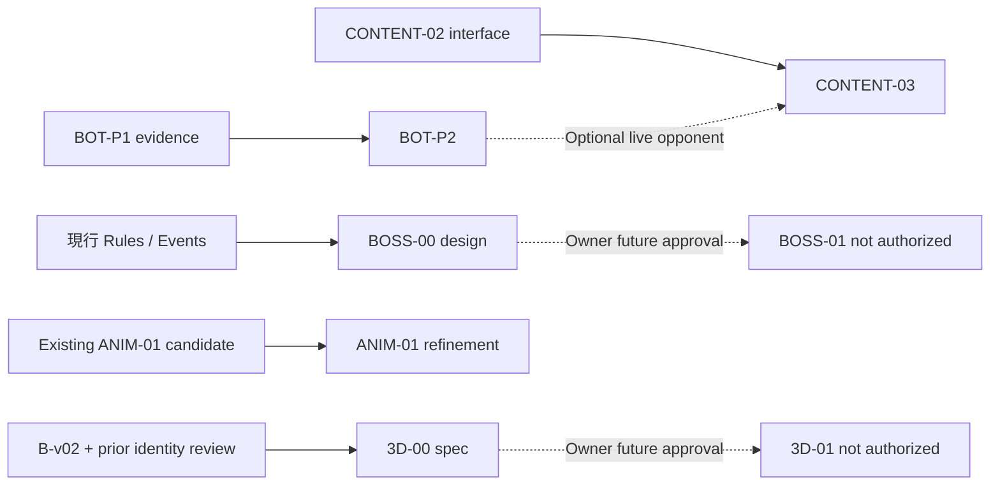

# TacticalGo｜Codex 五項 Slice 合約（合輯）

> Planning v1.0 / 2026-10-11。僅文件／指令；本次無程式修改、提交、推送、合併或發布。


---

<!-- FILE: README.md -->

# TacticalGo｜五個 Slice 的 Codex 工作包

**版次：2026-10-11 / Planning v1.0**  
**唯一已授權行為：產出與審查工作合約／Codex 指令。**  
**未授權：在 TacticalGo 儲存庫中修改程式、建立提交、推送、合併 PR、安裝真機或發布。**

本包將已核准納入規劃的五個項目拆為獨立合約。核准「規劃範圍」**不等於**核准「程式實作」或「升格正式規則」。

## 文件清單

| 文件 | 用途 |
|---|---|
| `00_MASTER_CONTRACT.md` | 權限、基準、依賴、整合策略、跨 Slice Gate、測試與風險 |
| `01_BOT-P2.md` | 改善電腦中後期攻守、區分合理／不合理 Pass |
| `02_CONTENT-03.md` | 三個有多回合反制的進階戰術關卡 |
| `03_BOSS-00.md` | 紅龍戰場規則設計合約（只定義，不寫遊戲程式） |
| `04_ANIM-01.md` | 法師「魔法之手」角色動作精修（沿用既有候選） |
| `05_3D-00.md` | 3D 角色身份、風格、製作規格（只定義，不建模） |
| `06_CODEX_HANDOFF.md` | 可直接貼給 Codex 的「先讀取／檢查」指令、五個單片啟動指令範本 |
| `07_GATE_CHECKLIST.md` | Owner 驗收／決策紀錄格式 |

## 建議閱讀順序

`00_MASTER_CONTRACT.md` → 選定 `01`～`05` 的單片合約 → `06_CODEX_HANDOFF.md` → `07_GATE_CHECKLIST.md`。

## 現有專案資料與確認邊界

- 2026-10-11 查詢的 GitHub `main` 最新提交：[`cdab133`](https://github.com/Gavin0099/TacticalGo/commit/cdab133cd469dd185fd8ca3f47fea2e217cfb139)（提交日 2026-10-09）。
- [BOT-P1 PR #5](https://github.com/Gavin0099/TacticalGo/pull/5) 與 [CONTENT-02 PR #6](https://github.com/Gavin0099/TacticalGo/pull/6) 提供實作候選與證據。**Codex 執行前須重新查驗 PR、工作樹與實際 Head，不得假設已合併。**
- 近期本機另有法師 ANIM-01 候選及 SELL-01C UI 候選；這些內容未必存在於 GitHub `main` 或同一個 worktree，需由 Codex 本機核對。此包不宣稱已讀取本機 ZIP、模擬器錄影或工作樹。
- 權威優先序：Owner 最新明確決策 → 最新有效 repo 指令與 `docs/DECISIONS.md` → 生效規則／Core 與 Golden → 候選 PR／實驗資料 → 本包建議。若衝突，列出衝突並保持 HOLD，不擅自選擇。

## 所有 Slice 共有的結案格式

1. **結果**：`PLAN_READY`、`ENGINEERING_CANDIDATE`、`OWNER_ACCEPTED`、`HOLD` 或 `BLOCKED`，不能混用。
2. **範圍**：讀取的基準 SHA、工作樹、PR、變更路徑；是否改動規則、預設與存局格式。
3. **證據**：命令、實際 PASS/FAIL、Golden 回歸、固定局面重播、對照圖／影片及其版本。
4. **仍待驗收**：真人策略、美術身份、iPhone/iPad 真機、相容性、發布權利逐一標註。
5. **下一個 Gate**：由 Owner 決策；不得把可編譯／可運作當作自動合併或發布授權。


---

<!-- FILE: 00_MASTER_CONTRACT.md -->

# TacticalGo｜五項工作 Master Contract

**版本**：Planning v1.0｜2026-10-11（Asia/Taipei）  
**工作性質**：交付 Codex 的設計／工程合約，**本次不執行工程修改**。

## 1. 使命、非目標與四層狀態

使命：保留已可玩的 7×7／9×9 核心，增加「有反制的策略選擇」與「角色表演品質」，同時阻止未核准的紅龍規則和失真 3D 模型進入正式路線。

- **規劃核准**：本包五個 Slice 都核准進入細部規劃。
- **工程候選**：程式／素材實作與測試通過，只表示候選可供 Owner 測試。
- **Owner-accepted validation debt**：Owner 明確允許某項未完成的驗證延後，附條件與負責人；不等於該驗證已 PASS。
- **正式採納／發布**：需要另外明確決策；工程測試、模擬器影片、PR 與真機安裝都不自動代表採納。

本輪禁止：寫入 repo、提交、push、merge、發版、改正式 Core 規則、偷偷啟用 R3、補新英雄、加第二技能、做 BOSS-01、開始完整 3D 建模／骨架、購買或使用未審權利素材。將來某片若另外獲得開發授權，仍不得自動擴大到上述其他片或發布。

## 2. 實際已確認的起點

| 項目 | 已確認／待確認事項 |
|---|---|
| GitHub `main` | 2026-10-11 查詢為 `cdab133cd469dd185fd8ca3f47fea2e217cfb139`；與本機最新工作樹可能不同 |
| 規則 | 每回合 2 AP、先手首回合 1 AP；行動／召喚／技能每次 1 AP；每回合最多一次技能；主將被提即敗；英雄被提不可重召；Core 原子結算與 Ko 不可破壞 |
| BOT-P1 | [PR #5](https://github.com/Gavin0099/TacticalGo/pull/5)：診斷層追蹤及兩手斬首反例；第 40 回合 Pass 有防守見證，第 55 回合仍不宜草率診斷 |
| CONTENT-02 | [PR #6](https://github.com/Gavin0099/TacticalGo/pull/6)：六關原版戰術挑戰、選關、提示、驗證、復原與獨立存檔；玩家回饋是六關太直覺 |
| R3 | opt-in 候選：戰士沿施放前相連棋群築壘、法師調度己兵到原群邊界；原版仍為預設，未做正式平衡認定 |
| 動畫 | 本機已交付法師「魔法之手」動畫候選（使用者提供）；Codex 要先查其原始資源、事件接線、影片與驗證報告，不要重新命名覆蓋 |
| 3D | 戰士 head-v02 的技術研究保留，但角色身份驗收未通過；目前採 A0 B-v02 原畫＋A Token＋2.5D 棋盤，3D 只允許規格研究 |
| UI | SELL-01C 最新候選與本機修整不保證在 `main`；任何 Gameplay／動畫分支要避免覆寫該線 UI |

**先讀文件**：`AGENTS.md` 與其有效基底、`docs/DECISIONS.md`、`docs/RULES_DRAFT.md`、`ios/README.md`、`docs/ios/V2_ASSET_CONTRACT.md`、`docs/ios/CHARACTER_PRODUCTION_ROUTES.md`；各片再依合約加讀專屬文檔。

## 3. 依賴矩陣

| Slice | 硬依賴（缺失即 HOLD） | 軟依賴／可並行 | 不得偷渡的後續工作 |
|---|---|---|---|
| BOT-P2 | 可重播的 BOT-P1 證據；正確 Core、測試基準；Owner 指定實作基線 | CONTENT-03 可先設計 | 強迫落子、規則變動、無證據調整難度 |
| CONTENT-03 | 可使用的 CONTENT-02 挑戰進入／存檔合約，或 Owner 同意先交資料與 fixtures | BOT-P2 若需要一般電腦動態反制 | 修改舊六關、擅自啟用 R3、加新技能 |
| BOSS-00 | 現行規則／事件／Ko／重播合約 | BOT-P2、CONTENT-03、3D-00 | BOSS-01 規則實作、紅龍模型、隨機開局上線 |
| ANIM-01 | 現有法師動畫候選／原 B-v02 素材／事件播放介面可檢查 | 3D-00 不必完成，與 BOT-P2 邏輯隔離 | 建模、改 Core、變更音樂、加入英雄語音 |
| 3D-00 | B-v02 原畫與可追溯來源；既有建模失敗與決策文件 | ANIM-01 可同步 | 新模型、頭雕、骨架、USDZ、App 接線 |

簡化依賴圖：



**重要整合衝突**：PR #5 和 #6 都源自 `cdab133` 且涉及 `memory/**`。未獲授權不得為了「方便」先合併或 rebase；未來由 Owner 決定合併順序，Codex 需保留兩邊獨立證據與規範化記憶紀錄，不能丟掉其中一側的記錄。

## 4. 每個 Slice 實作前的 Preflight Gate（本包只要求準備，非已完成）

1. 以唯讀方式記錄 `git status --short`、`git rev-parse HEAD`、工作樹路徑、遠端 PR Head、未提交差異與產物 SHA。**不要**因 dirty tree 而自動 reset、stash、清理、checkout。
2. 讀有效 `AGENTS.md` 與框架規範，列出限制；檢查被要求工作的本機候選是否可存取，缺失就列 `MISSING_INPUT`，不冒用另一分支或舊素材。
3. 判定實作基線：有些功能在 PR #5/#6，部分候選在本機。採用哪一個基線需可追溯；若無法安全判定，先 `BLOCKED`，不得改 main。
4. 先取得既有 Golden、Swift package、原生測試的 baseline receipt；新 Slice 只改自身允許路徑，必要共用路徑提出整合方案供審查。
5. 形成 `PLAN.md`、變更／風險清單、fixture 清單、回退策略與 Owner 驗收表，再開始任何另行授權的實作。

## 5. 共同工程原則（僅對未來獲得實作授權的 Slice 生效）

- **Core 唯一真相**：預覽不 commit，只有成功 action 的 Core outcome/events 能觸發正式盤面、資源與播放；UI、動畫、Bot 不另寫氣、提子、自殺、Ko 判定。
- **規則原版保護**：`original` 仍是預設，R3 必須 opt-in 且另存副本；任何新規則要有獨立 profile、Golden、存局／棋譜版本與退出路線，未核准不替換正式。
- **可重播與無隨機 side-effect**：同一完整 state、設定、種子與行動序列必須有同一結果；Bot、內容與動畫不能使用時鐘作為規則決策。
- **異常與取消**：undo、restart、離開、背景、延遲 Bot 結果、Reduced Motion、壞存檔，均須不造成第二次提交或幽靈棋子。
- **隔離交付**：各片各自測試、紀錄來源、保留明確版次，不讓 SELL-01C UI 或其他美術工作被意外覆蓋；不以便於整合為由跨片重構。
- **測試收據**：命令、commit/source SHA、環境、PASS/FAIL 數量、影片型別（模擬器／真機、音效是否後製）需如實記錄。不得沿用修改前過期收據。

## 6. 共用測試矩陣

| 變更類型 | 必要回歸（實作時） | 加值／真人驗收 |
|---|---|---|
| Bot 評分／搜尋 | Swift Bot/Package、可重播 40/55、立即勝負／救援／非法避免／預算不足、整局比較、Golden | 真機每回合節奏、玩家是否能預測與反制 |
| Challenge Controller／資料 | Core 合法性、固定分支、提示與失敗、save/undo/Ko、原六關與 38 組 Golden、原生 SE/iPad | 至少一次不看提示的 Owner 試玩；能說出失敗決策的原因 |
| 新環境規則 | **BOSS-00 僅做手算 trace／規則一致性論證，不執行程式** | 由 Owner 判定勝負與中立效果優先順序，才可立 BOSS-01 |
| 動畫 | Core events 不變／只成功播一次、預覽取消、Reduce Motion、背景與 undo、SE/iPad 兩種方向影片 | 身份、抬手／揮杖、打擊感與聲畫同步，需 Owner 看實際畫面 |
| 3D 設計規格 | **3D-00 文件與 reference 稽核，不製作模型或執行 App build** | 原畫身份特徵表、未定正側背假設及下一步 stop gate 由 Owner 核准 |

共用參考命令（以現有 checkout 與可用 toolchain 為準，**不是本次已執行**）：

```bash
swift test --package-path swift/TacticalGoCore
python3 scripts/verify-ios-parity.py  # 依環境另指定 TACTICALGO_DOTNET；先核對腳本需求
xcodebuild -project ios/TacticalGo.xcodeproj -scheme TacticalGo \
  -destination 'platform=iOS Simulator,name=iPhone 17' \
  CODE_SIGNING_ALLOWED=NO test
```

Golden 既有基線：38 組／99 步／137 snapshot（不同分支上的數字需重新確認）；測試數字只可作歷史資訊，**不能預先填成新片 PASS**。

## 7. 整合與決策關卡

- `G0-BASELINE`: 基準、PR、工作樹來源、既有候選與權限核對；不確定則 `BLOCKED`。
- `G1-DESIGN`: 有範圍、非目標、具體失敗情境、觀測指標與回退方案；由 Owner 決定是否實作。
- `G2-ENGINEERING`: 實作候選在隔離環境測試，回歸與證據可重現；PASS 只對工程有效。
- `G3-PLAYTEST/ART`: Owner 以真人對局、實機動作或原畫對照決定 `GO / REVISE / HOLD`。
- `G4-ADOPTION`: 另外核准合併、正式預設、真機安裝或發布；任何一項都不是 G3 自動結果。

**每階段停止條件**：不可證明是新能力而非規則錯誤、Bot 只能靠非法簡化改善、三關仍只靠直覺一步完成、龍息沒有可預告反制、法師身份在動畫中變形、3D 頭部仍不像原角色、Core／Golden 被無關動作修改、存局／可復原性下降。觸發後產出 HOLD 報告，不用大量新功能掩蓋。

## 8. 安全回退與交付版控

- 不動既有正式存局，不清除／重置進度、不覆寫目前候選圖片與報告。
- 每片的文件／fixture／影片／程式應能清楚指出原始基線與目標 SHA；程式實作若未獲授權，不得把資料包當 PR 直接推送。
- 影片與影像產物標示：原生擷取、後製、模擬器或真機，不能互換。
- 只有 Owner 明確同意，才可處理相依 PR 的 merge/rebase、替換預設技能、實機安裝、3D 素材升格與 App 發布。

## 9. 參考與追溯

- [現行 main commit](https://github.com/Gavin0099/TacticalGo/commit/cdab133cd469dd185fd8ca3f47fea2e217cfb139)
- [規則草案](https://github.com/Gavin0099/TacticalGo/blob/main/docs/RULES_DRAFT.md)
- [Owner 決策](https://github.com/Gavin0099/TacticalGo/blob/main/docs/DECISIONS.md)
- [BOT-P1 PR #5](https://github.com/Gavin0099/TacticalGo/pull/5)
- [CONTENT-02 PR #6](https://github.com/Gavin0099/TacticalGo/pull/6)
- [素材介面](https://github.com/Gavin0099/TacticalGo/blob/main/docs/ios/V2_ASSET_CONTRACT.md)
- [角色製作路線](https://github.com/Gavin0099/TacticalGo/blob/main/docs/ios/CHARACTER_PRODUCTION_ROUTES.md)


---

<!-- FILE: 01_BOT-P2.md -->

# BOT-P2｜電腦中後期攻守改善｜工程合約

**性質**：未來可實作 Slice；本輪只有規劃文件。  
**承接**：BOT-P0、BOT-P1、既有 `TacticalGoBot`。  
**風險**：L2（決策演算法、電腦回合、非同步取消與玩家體驗）；不得改 Core 勝負／合法性規則。  
**工作範圍**：7×7 原版與 opt-in R3 兩個設定隔離比較；單人簡單／標準兩種難度。

## 1. 核心問題及成功定義

已知診斷：標準 Bot 在密集局面可能反覆 Pass。BOT-P1 指出第 40 回合多數進攻／落子會在對手完整兩手內造成主將被斬首，因此 Pass 可能正確；第 55 回合列舉的 96 種完整己方回合未找到相同兩手斬首反例，但評分仍選擇 Pass，不能直接推論「所有 96 種都應下」或「單純搜尋寬度不夠」。

**要解的是**：在安全且有戰術價值的選擇存在時，Bot 是否能前進、建立威脅／換取氣、保存 Mana、預防敵手組合攻擊？避免的不是 Pass 本身，而是無必要的長期保守。

假設：局部行動排序、分層結果評估／長期生存價值、威脅形成與結束回合比較方式，可能造成第 55 回合未採取有價值的安全行動。**這是待驗證假設，不是已定位的根因。**

## 2. 不可改的合約

- 原有原子規則、棋串／氣數、Ko、自殺、提子、主將斬首、2 AP／首回合 1 AP、Mana、技能次數、英雄召喚／死亡、原版／R3 隔離均不動。
- Bot 只能透過 `Core.legalActions` / `Core.apply` 檢查候選；不另寫「模擬比較簡化版」勝負或氣數。
- 保持同輸入、同預算、同版本下決策與 trace 可重現；不使用未定種子的亂數、不以裝置時間影響戰術。
- 不增強 AI 到完全搜尋、神經網路、不加入對局規則變化，不改 UX／美術／音效。
- 不以「Pass 次數下降」或「平均局數縮短」單獨宣稱 AI 變好；更不能硬禁 Pass。

## 3. 工作拆段（每段均可 HOLD）

**P2-A｜基準重播與最小原因分類**

1. 讀取 PR #5 的 `docs/bot-p1/PLAN.md`、`artifacts/bot-p1/REPORT.md`、`evidence.json`、第 40／55 回合完全可重播盤面；核對 PR Head 與工作樹、原版／R3 mode、難度、資源、輪次、Bot 決策與安全性。
2. 先記錄 traced／untraced 同步性、所有安全/不安全候選、己方完整兩手與敵方兩手回應；若證據不齊，停止在 `BLOCKED_INPUT`，不得拿「近似棋形」代替。
3. 定義 Pass 原因分類：`forced_defense`（有敵方可驗證斬首見證）、`safe_but_passed`（找到安全且優於 pass 的候選，須有可重現價值理由）、`no_useful_safe_move_evidenced`（檢查範圍內未找到值得落子的選擇）、`budget_unknown`。不可從搜尋缺席推論安全。

**P2-B｜限定版候選改進**

1. 在不破壞原搜尋預算／確定性的前提下，設計至多兩種可切換的候選改善：例如保留會產生中期棋形威脅的行動、比較己方完整回合的防守餘裕、建立「安全的局部進度」評分。先選最低風險的單一變更測試，另個候選可保持 Draft。
2. 先在第 40／55 回合對照 `baseline vs candidate`，逐筆提供：前後盤面、合法動作、AP、Mana、主要威脅、對手最危險兩步回答、分數與調整原因；禁止只貼最終一手棋。
3. 若 Bot 再度 Pass，需能顯示合理原因；如果只是改常數讓 F7／G6 得分更高，卻沒有被動兩手安全證據，視為 FAIL。

**P2-C｜對局與 UI 生命週期回歸**

1. 固定三組以上正式開局 pairing／設定（原版、R3、至少兩種職業組合），同一 source SHA 對 baseline 與 candidate 進行完整可重播比較；100 回合上限資料照實報告。
2. 比較安全進度：有效威脅形成、由 Pass 轉為行動的局面、形成的反制、斬首／和局分布、非法 action 數、搜索預算耗用、思考耗時；不以少量自動對局推論真實勝率或樂趣。
3. 原生逐手播放、undo、重開、背景切換、遊戲離場、難度變更、晚到 Bot 產物作廢和選白方首回合 1 AP，須無二次提交、無舊決策污染。

## 4. 必備回歸／測試案例

| ID | 條件 | 預期 |
|---|---|---|
| BP2-01 | R3 第 40 回合，對手完整兩手斬首見證 | 若仍 Pass 可接受；不得為降低 Pass 而選被直接斬首的招 |
| BP2-02 | R3 第 55 回合與 F7／G6 對照 | 提供完整候選風險／分數對照；無合理驗證就標 HOLD，不硬說落子較優 |
| BP2-03 | 有立即合法斬首 | 不因保守進度分而錯失當回合勝利 |
| BP2-04 | 主將危險，需要兩 AP 救援 | 完整回合評估生存，首手不能導致第二手無法救 |
| BP2-05 | 先手首回合 1 AP／僅剩 1 AP | 不輸出超額 action、不跳過唯一必要救援 |
| BP2-06 | 英雄死亡、Mana 不足、技能已用 | 全候選由 Core 驗證，沒有幽靈技能／未授權重召 |
| BP2-07 | 搜尋預算不足／取消／敵手結果晚到 | 合法完整 fallback、無過期提交；未完成 enemy search 不冒充安全 |
| BP2-08 | 棋盤緊密／無值得走的棋 | 可合理選 Pass，不因「進度壓力」做自殺或送主將 |
| BP2-09 | 原版與 R3 獨立測試 | 無規則或預設設定漂移；兩組歷史 Golden 仍 PASS |
| BP2-10 | Trace flag 開啟 vs 關閉 | 除詳細記錄外，行動／分數／候選順序與工作量一致，或列出有理由差異 |

## 5. 可量測 Gate

- **G-BP2-0（證據）**：40/55 均可重播且比對原 PR 完整狀態、每步 events、預算；無缺失。
- **G-BP2-1（診斷）**：提出可檢驗的候選差異原因，分清 `forced_defense`／`safe_but_passed`／`unknown`，包含至少一個故意錯誤方案的反例。
- **G-BP2-2（工程）**：至少一個過去不必要 Pass 的合法可達局面，候選在不增加可驗證兩手送主將風險下形成有效威脅；BP2-01～10／現有 package／Golden 全過。若安全進度根本找不到，不能假造 PASS，維持 HOLD。
- **G-BP2-3（非退化）**：搜尋成本在相同硬體／測資上與基準比較；預設目標為 median 受控（候選不超過基準約 25%）且沒有嚴重操作卡頓，偏離須量測與 Owner 接受，非硬性冒用不同硬體的秒數。
- **G-BP2-4（真人）**：Owner 至少完整試玩 2 局，描述電腦進攻目的、可否反制、是否仍有無意義等待。這是獨立的 GO/REVISE/HOLD，不以 benchmark 代替。

## 6. 預期交付

`PLAN.md`、`BASELINE.md`、可重播 trace 與命令、候選差異對照表、固定局面與反例、測試報告、source／fixture manifest、原生試玩錄影或操作收據、`OWNER_PLAYTEST.md`、`DECISION.md`。候選需要能關閉並返回 baseline；不得變更正式局儲存語意。

**停止條件**：只能用硬禁 Pass 降低數量、威脅判斷在 Core 中不可重播、引入必敗斬首、預算或卡頓無法控制、失去確定性、損害原局／復原、未取得 BOT-P1 來源。觸發即 HOLD。

**參考**：[BOT-P1 PR #5](https://github.com/Gavin0099/TacticalGo/pull/5) · [`docs/ios/BOT_01.md`](https://github.com/Gavin0099/TacticalGo/blob/main/docs/ios/BOT_01.md)


---

<!-- FILE: 02_CONTENT-03.md -->

# CONTENT-03｜第二章三個進階挑戰｜工作合約

**性質**：未來可實作 Slice；本輪只規劃。  
**承接**：CONTENT-01 六個 fixture、CONTENT-02（PR #6）的挑戰 Controller／iOS 選關、獨立進度。  
**目的**：回應 Owner 完全不看提示就完成六關，且覺得幾乎不用思考的體驗；不是把六關加長或加華麗演出。

## 1. 範圍與不改項目

- 追加「第二章」**三個** 7×7 進階戰術挑戰；仍沿用現有士兵／主將／三職第一技能、2 AP、原子提子與 Ko。
- 第二章的敵人**必須能反制**：第一版允許限定局面的決定性「對手回應腳本／規則有效的策略」，不必硬依賴尚未通過的 BOT-P2；若選用一般 Bot，必須另外驗證來源與可重播性。
- 每關都應至少經歷玩家作出一個計畫、敵方作出有意義回應、玩家需要修正或完成計畫的循環。不是單看棋形多幾顆子。
- 不動舊六關的內容、難度或通關資料；不擅自切換到 R3；不增加第二技能、紅龍、裝備、抽卡或獨立規則求解器。
- 不藉新關重寫 `TacticalGoCore` 合法性；所有 replay、undo、Ko、AP/Mana 必須由既有 Core 保證。

## 2. 三個固定候選（先寫設計與證明，再選盤面）

| 關卡 | 玩家要處理的問題 | 必須有的反制／取捨 | 失敗訊息應說明 |
|---|---|---|---|
| **C03-1 主將救援：守住下一回合** | 主將被威脅，玩家不只需填一口氣，還需判斷下一回合對方的兩手組合 | 看似直接救援的一手仍可能被連續攻擊；至少存在一條能存活的合理方案 | 哪一個氣／棋群被忽略，以及敵方如何利用 2 AP |
| **C03-2 佯攻與反打** | 用對方反應創造新的提子機會 | 不能單靠立即提一子就結束；對手會優先救援／反擊，玩家要安排次序 | 是哪一個威脅引出了對手的回應，而不是「答案錯」 |
| **C03-3 技能時機與 Mana** | 何時施法、何時落子，考驗技能成本與行動順序 | `技能→落子`、`落子→技能`、`兩次落子` 至少存在風險／效率差異；必須能示範不值得施法的情況 | 說清楚資源、氣數、合法性與後續反制的實際結果 |

上表是**設計目標，不是已找到且已驗證的棋形**。Codex 必須從真實 Core 合法狀態找出或建構盤面，再用可重播序列驗證。不能先寫劇情，再偷偷改 Core 讓劇情成立。

## 3. 內容設計合約

**C03-A｜前置盤面與來源**

- 記錄模式（original 或明確另標的候選）、棋盤 7×7、先後手、黑白執色、職業、英雄存活、Mana、AP、回合與 superko 歷史。
- 盤面必須提供從合法 newGame 到達的可信重播路徑，或明白標示為獨立 editor fixture 且經所有合法性檢查；若沒有完整 Ko 歷史，不得宣稱等同自由對戰的歷史可達局面。
- 設計目標及失敗條件由已提交 Core events／state 驗證，不以 UI 文案或動畫決定。

**C03-B｜反制與策略深度**

- 玩家與對手在各自回合遵守現行 AP／技能／Mana 限制。對手不許「無條件跳過回合」假裝反制。
- 每關至少保存：1 條預期可解路線、1 條看似合理但會失敗的路線、1 條合法替代方案或明確紀錄在受控搜尋範圍內未找到替代；不能把「某有限搜尋沒找到」寫成全域唯一解。
- 對手回應若 scripted，需記錄依據 state 的條件，不得無視玩家棋形硬套固定座標行動；若不同分支導致無合法腳本，應 fallback 到經 Core 驗證的有限反應或明確評估失敗。
- 提示分級：第一階指出戰術目標、第二階提醒被威脅棋群／資源、最後才透露具體方向；不能預設顯示最佳路線。無提示也能理解勝敗原因。

**C03-C｜整合與持久化**

- 沿用 CONTENT-02 的 `ChallengeController`、結果／下一關／重試／undo 與獨立 journal。先核對 PR #6 是否合併，再決定引用 Head；缺 PR 來源只能先交內容規格與 fixture，不直接重建整套 Controller。
- 無舊六關進度資料遷移；第二章 ID 獨立且穩定，返回大廳、重啟 App、失敗重新開始不影響正式對局。
- 當結局確定立即鎖定互動；撤銷須使用已接受的動作重播還原，保留 Ko 歷史與 Mana。

## 4. 測試設計（每關都要有獨立證據）

| ID | 驗收案例 | 預期 |
|---|---|---|
| C03-T1 | 玩家標準成功路線 | 合法多回合完成，Core outcome/事件與目標一致 |
| C03-T2 | 貪攻或盲目救援 | 敵方實際反制，能顯示確切失敗原因 |
| C03-T3 | 不用技能／使用技能／調換行動順序 | 有價值的取捨，非只要求按指定按鍵 |
| C03-T4 | 提前結束回合、Mana 不足、主將剩一氣 | 敵手與結局正確處理，不落入假勝利 |
| C03-T5 | undo／retry／resume／關卡切換 | 完整盤面、Ko、資源及終局鎖定正確 |
| C03-T6 | 角色不同／黑白反向（適用時） | 不合法設定明確限制；若不支援則不讓玩家誤選 |
| C03-T7 | 原六關與正式存局 | 舊內容進度與 MatchSave 逐位或語義上不被改動 |
| C03-T8 | iPhone SE / iPad 直橫 | 目標、結果、資源、棋盤點選可理解，沒有遮擋 |

測試方法：固定合法序列 replay、範圍界定的反例搜尋、既有 Swift tests、38 組 Golden／C#-Swift parity（若本片觸及相關程式）、iOS native tests。**工程證明的是可解／合法／可反制，不是玩家覺得難得剛好。**

## 5. 完成 Gate

- **G-C03-0／依賴**：能使用 PR #6 的挑戰入口與隔離進度合約；或本 Slice 明確降為 `DESIGN_ONLY`，不偽稱可玩。
- **G-C03-1／內容**：三關各有遊戲規則與局面合法性證據、至少一條成功序列與一條合理錯誤序列；不是抄重舊六關或把提示藏起來。
- **G-C03-2／工程**：玩家與對手都使用 Core 合法動作，分支路線可重播且完結，原六關、存局、Golden、原生回歸均 PASS。
- **G-C03-3／真人**：Owner 第一輪不看提示玩三關，記錄每關是一次理解就通過、經過幾次策略修改、失敗是否能解釋、是否想換職業再玩；建議另找至少 2 名不同背景玩家作方向性試玩。**不設「一定要失敗」作為假難度目標。**
- **STOP**：三關仍幾乎不用思考、失敗全靠陷阱或隱藏規則、對手沒有實質反制、唯一可解但不合理、存局污染或需暗改預設技能 → HOLD/REVISE。

## 6. 交付包

`CONTENT03_DESIGN.md`（含三關狀態圖／提示／成功失敗文案）、`fixtures/*.json`（若後續已授權實作）、`solution-and-counterplay.*`、Core replay command、 bounded-search 範圍說明、`VALIDATION.md`、iPhone/iPad 錄影與 `OWNER_PLAYTEST.md`。資料型關卡與可玩 UI 應分開標狀態；不能把 3 個 fixture 當成 3 個已發布關卡。

**參考**：[CONTENT-02 PR #6](https://github.com/Gavin0099/TacticalGo/pull/6) · [`docs/DECISIONS.md`](https://github.com/Gavin0099/TacticalGo/blob/main/docs/DECISIONS.md)


---

<!-- FILE: 03_BOSS-00.md -->

# BOSS-00｜紅龍首領戰規則設計｜文件合約

**性質**：純設計／規格 Slice。本片**不得修改 Core、建立 BOSS-01、繪製模型或將紅龍放入可玩版**。  
**目標**：定義「可預告、可利用、有反制」的環境首領，使 TacticalGo 保留決定性戰術，而不是加入無預警的隨機懲罰。  
**依據**：`docs/PLAN.md` S4 的紅龍概念：天元紅龍、怒氣、預告方向、三格直線推擠／撞擊是歷史候選，非已採納規則。

## 1. 必答設計問題

BOSS-00 結案前，所有問題應有 `SELECTED / REJECTED / OPEN` 與理由；無明確 Owner 選擇不進 BOSS-01。

| 問題 | 候選 A | 候選 B | 目前狀態 |
|---|---|---|---|
| 紅龍是否佔棋盤點位？ | 視覺 overlay，不是 Core 棋子、不佔氣 | 真正中立單位／地形點，阻擋合法落子 | OPEN；先比較侵入性與可讀性 |
| 何時預告？ | 玩家方行動前固定顯示，下一個環境階段執行 | 每雙方各一回合後才執行 | OPEN；需確認回合一致性 |
| 攻擊方向來源？ | 固定四方向循環（完全決定性） | 根據可見棋形決定（仍需 deterministic） | OPEN；不先引入 RNG |
| 龍息效果？ | 暫時限制落子（類似封印，不改已落棋子） | 三格推動／撞擊棋子，可能造成提子 | OPEN；後者是高風險玩法候選 |
| 龍息是否能斬首？ | 第一版禁止直接透過環境立即擊殺主將 | 允許，但需完整定義歸屬與同時死亡 | OPEN；預設先驗較公平方案 |
| 玩家勝利條件？ | 仍以提吃對手主將獲勝 | 新增「擊敗龍」勝利 | OPEN；不先做龍血量或掉寶 |

**目前最小原型建議**：7×7、無血量／掉寶／裝備、只一條三格預告線、固定方向循環，視覺 overlay 不佔 Core 點位；但是「龍息究竟限制落子或推棋」仍需比較兩個可手算範例後才能定案。不可把本建議直接寫成正式規則。

## 2. 需要閉合的規則合約

**B00-A｜時序與 State Machine**

定義狀態例如 `Dormant → Telegraphing → Resolution → Cooldown → Telegraphing`。每個階段明確標註：何方回合、何時消耗 AP（環境不應無故消耗玩家 AP）、Mana 與技能旗標有無影響、預告起訖時間、勝負檢查先後、背景／復原後可否重建。必須處理先手首回合 1 AP 導致的非對稱開局。

**B00-B｜格點與棋群**

明訂龍的位置是否佔格、是否算阻塞、是否算氣、能否落兵／召喚／施法／換位／築壘到龍息格、封印與龍息衝突如何結算。若龍息只是一種視覺狀態，所有棋群／氣數仍由現有 Core 決定；若龍息移動棋子，不能由 View 直接改 `GameState`。

**B00-C｜中立事件原子性**

若選推擠／撞擊：須規定移動先後（同一原子事件還是逐格依序）、越界／被佔格／多顆棋串、提敵／提己、主將／英雄死亡、同時雙方主將消失、Ko／superko、禁止自殺、勝利歸屬、是否允許玩家反應。這些問題不閉合就不得進入下一階段。

**B00-D｜重播與儲存**

環境狀態、攻擊方向、警告格點、phase、計數器及任何隨機種子都必須可儲存／重播。相同初始 state 與同一串合法行動必須得到相同事件與棋盤；不允許由動畫時間或畫面幀決定龍息觸發。存檔需要 mode/schema 隔離，不能讓 BOSS 新模式污染正式原版存局。若引入新的 event/action，也要說明舊檔與 C#／Swift Golden 的相容策略。

**B00-E｜AI 與關卡公平性**

玩家能在操作前清楚看到攻擊範圍／剩餘階段，Bot 或腳本對手必須拿到相同資訊。不得只對玩家隱藏資訊，且盲目抽方向令玩家無法合理預測。首版仍要有一個防守解與一個利用龍息反擊的解法，否則這只是隨機清子。

## 3. 四份手算情境（本片只寫 expected transcript，不做程式）

| 情境 | 局面要求 | 必須產出 |
|---|---|---|
| B00-P1 預告可見 | 7×7、玩家知道下一次龍息格 | 標示受影響三格、攻擊前後回合順序、可以避開的行動 |
| B00-P2 利用龍息 | 敵方棋群有可能被影響，而玩家可誘導 | `防守` 與 `誘導攻擊` 兩條合理路線及風險 |
| B00-P3 主將一氣 | 龍息涉及主將最後一口氣或保護格 | 勝負／公平性決策，不存在未預告直接斬首 |
| B00-P4 特殊衝突 | 推動、棋群連通、Ko／碰撞或同時消失 | 原子事件順序與禁止狀態；不確定則 BLOCK |

棋盤與預期資料應用具座標的 ASCII 或 7×7 表格，逐 phase 記錄 AP、Mana、棋子、氣數、警告格、結算事件、勝負、Ko history。若選定方案無法給出一致結果，代表規則合約尚未完成，不能使用「交給程式決定」跳過。

## 4. 輸出文件（本片唯一交付）

- `BOSS00_RULE_CONTRACT.md`：術語、模式選擇、角色／環境界線、合法性與勝負、事件順序。
- `BOSS00_STATE_MACHINE.md`：phase 與轉移圖，包含兩側 2 AP／首回合 1 AP、死亡與提前結束回合。
- `BOSS00_OPEN_DECISIONS.md`：本章第 1 節決策表；每項 Owner 決議、拒絕理由與回退方案。
- `BOSS00_EXAMPLES.md`：四份可手算完整狀態 trace。
- `BOSS00_IMPLEMENTATION_BOUNDARY.md`：未來 BOSS-01 會觸及的 Core／事件／存局／Bot／動畫路徑、相容風險和先行測試清單（只規劃，不實作）。

## 5. Gate 與 Stop 條件

- **G-B00-0｜規格來源**：區分歷史草案與這輪候選，不宣稱「天元、怒氣、三格推擠」已採納。
- **G-B00-1｜時序閉合**：所有 phase 可手算且無跳步，2 AP／Pass／復原／重播一致。
- **G-B00-2｜環境與 Core 相容**：對氣／提子／Ko／主將死亡／雙方同時死亡／事件原子性提出明確決策，無模糊例外。
- **G-B00-3｜戰術價值**：至少各一份躲避與利用龍息的可理解選擇；清楚預告，沒有純運氣懲罰。
- **G-B00-4｜Owner 決策**：Owner 選定 MVP 效果／mode／勝負規則並認可 BOSS-01 的風險，才可另外授權實作。

**HOLD 條件**：依賴即時亂數才有趣、龍息與 Core 原子結算衝突、沒有可靠的預告介面、只能增加玩家操作負擔、出現無預警斬首、開始寫遊戲程式或製作龍模型。現階段不做自動平衡模擬，也不把單一有趣概念當 G-B00-3 PASS。

**參考**：[`docs/PLAN.md` S4](https://github.com/Gavin0099/TacticalGo/blob/main/docs/PLAN.md) · [`docs/RULES_DRAFT.md`](https://github.com/Gavin0099/TacticalGo/blob/main/docs/RULES_DRAFT.md)


---

<!-- FILE: 04_ANIM-01.md -->

# ANIM-01｜法師「魔法之手」角色動作精修｜合約

**性質**：未來可執行的原畫／動畫改良 Slice；本輪只交付指令。  
**命名注意**：使用者先前已有一個 **ANIM-01 魔法之手候選**（iPhone 安裝／原生影片與交付包）。本新規劃沿用使用者指定的顯示名稱 ANIM-01，但實際 branch／artifact 建議用 `ANIM-01R`（Revision），**不得覆蓋舊 ANIM-01 原始資源與收據**。  
**依賴**：A0 B-v02 法師身份、當前 `BoardPlayback`／Core success events、先前 ANIM-01 候選資產與事件演出。

## 1. 要改善的不是粒子數量

目標是讓玩家看到「法師施法的角色表演」：**準備 → 抬手／握杖 → 指向目標 → 棋子被推動 → 回穩**。若角色仍是一整張立繪縮放或左右移動，即使法陣漂亮，也不能宣稱 ANIM-01 的「抬手揮杖」達成。

第一輪禁止英雄語音、替換 BGM、替換角色身份、全身 3D 建模、重新繪製法師的臉、修改 `TacticalGoCore`/技能合法性／Mana 與 AP。不擴展戰士／盜賊／紅龍動畫。

## 2. Baseline 查核（未驗證前不得開新動畫）

Codex 需先唯讀檢查本機先前交付的 `artifacts/anim/anim-01/REPORT.md`、動畫 source / import ZIP、iPhone／模擬器錄影、法師當前 PNG、source SHA、實際動畫事件接線。使用者先前提供的是 26.25 秒模擬器原生畫面＋後製音效，**不能稱為系統音訊實錄或本輪新動畫驗收**。另查視覺模式是否仍採原 B-v02 卡＋A Token。

輸出一個 `ANIM01R_BASELINE.md`，至少包含：哪些動作是角色拆層、哪些只是整張 Sprite 變換；是否有披風／帽子單獨 motion；目前的施法成功事件與攻擊目標對位；有無 R3 自己士兵調度；Reduced Motion；原聲／後製聲區分。若本機來源不存在，先用 existing source 做**不改動**的比較規格，標 `BLOCKED_INPUT`，不得重製外觀相近但身份不同的法師。

## 3. 最小可交付演出

| Phase | 畫面／動作 | 驗收要點 |
|---|---|---|
| A0 Ready | 法師原站姿、底座正常、無額外重影 | 角色與棋盤座標一致，黑白方標記清楚 |
| A1 Anticipation | 法師上半身先動、握杖手與杖的方向有明確變化，帽／衣跟隨 | 不能只放大整張圖；肢體與法杖不分離 |
| A2 Cast | 轉向合法目標，杖端／手的 cue 與法術啟動同步 | 目標位置從 action／event 得到，不在動畫資料寫死座標 |
| A3 Impact | 被推或調度的士兵移動，到達後依 Core result 顯示提子／終態 | 不先於 confirm 偷換棋形；不二次提交 |
| A4 Settle | 身體、手、杖、披風在短暫收勢後回到穩定待機 | 動畫結束沒有飄移、手杖斷裂、ghost、跨回合殘影 |

時間配置由實際影片驗證後確定；可用短、清楚、非拖沓的基準片比較，不先發明「正式 0.8 秒」規則。保留有聲／無聲、正常速度／減少動態的檢視。

## 4. 實作路線需先經評估

- **路線 S（首選候選）**：2.5D 拆層 Sprite／簡單 rig。補畫遮擋處，保留 B-v02 五官、輪廓、帽子、晶杖與色彩。Source 必須可編輯、分層對得起來。
- **路線 T（臨時 fallback）**：整體動態＋法杖／效果 anchor，若沒有可用拆層原始檔，可做有限改善，但**不得宣稱角色真的抬手**。需另送 Owner 決定是否接受留為候選。
- **禁止的捷徑**：從被否決的 3D Mage 模型生成角色畫面並取代原圖、用粒子光效遮掩肢體沒有動、用不能追溯權利的素材拼貼。

3D-00 與本片**互不阻塞**。即使 3D-00 文件通過，也不代表可以改用 3D 人體骨架替代本 Slice 的 2.5D 路線。

## 5. Core 事件與生命周期限制

- 只有 Core 已確認的 `castMagicHand` / `piecePushed` 或 R3 已確認的相同語意事件，可觸發施法主動畫；`preview`、非法施法、取消選點不得播放 commit impact 或扣資源。
- 支援推敵兵、原版推進、若當前 R3 候選已具備的己方士兵調度；若某模式未在基線中提供，需標不支援，不能改 Domain 補出。
- `undo`、重新開始、離場、背景、晚到 Bot、快速切換技能、玩家方別與減少動態，必須立即使舊演出失效；後續新事件不能被舊 animation task 覆蓋。
- 嚴守 `BoardPlayback` 的事件順序，不在 animation completion 中做第二次 `Core.apply`；角色層不阻擋棋盤格點命中、不改 AP HUD、不吞勝負／提子事件。
- 音效只做現有 cue 的時間對齊，不新增配音或替換音樂；若展示影片後製配音，必須在標題及報告註明。

## 6. 測試矩陣

| ID | 測試 | 成功條件 |
|---|---|---|
| AM1-01 | 預覽／取消／非法目標 | 不播放正式施法或提子，不改資源 |
| AM1-02 | 合法施法成功 | 事件只消費一次、結果與 Core 完全一致、影格對準目標 |
| AM1-03 | 法師推己兵／敵兵（模式有提供時） | 棋子身份、陣營、方向、來源與終點都正確 |
| AM1-04 | 施法後提子／直接獲勝 | 先有正確 impact，再有提子／勝敗；不覆蓋結果 |
| AM1-05 | undo / restart / leave / background | 動畫可中斷、無 ghost 或舊 source 抵消新盤面 |
| AM1-06 | Reduced Motion | 直接呈現可理解的合法終態與必要提示，沒有多餘動態 |
| AM1-07 | SE、iPhone、iPad 直橫、7×7／9×9 | 角色身份不糊、目標不偏、技能按鈕與黑白字牌仍可辨識 |
| AM1-08 | Bot 下一步與人類輸入 | 不因動畫造成跨回合雙重提交或錯失取消操作 |
| AM1-09 | 與目前 A0／SELL-01C 視覺比較 | 同一資產檔不被未授權覆寫，來源可回退 |

自動測試需要對應原始 Swift Package／原生 UI 測試，測試可透過事件 trace 與結果快照核對；**角色動作的品質不能靠單元測試**。至少提供原始影格、iPhone 全畫面 before/after 錄影、停格接觸表及來源 ZIP／hash；拿到可用真機後再做觸控／觀看驗收，不能把模擬器稱成真機。

## 7. Gate

- **G-AM1-0（資產）**：舊 ANIM-01 與 B-v02 素材可核對，權利、來源、版本一致；缺漏即 BLOCKED。
- **G-AM1-1（角色身份）**：法師臉型／紫色頭髮／帽／晶杖不變；即使動畫流暢，身份不像也 FAIL。
- **G-AM1-2（真動作）**：Owner 在不看文字的短片中能看出「抬手／揮杖／收勢」三段，而不是只看見整張卡片縮放；目標方向可信。
- **G-AM1-3（工程）**：AM1-01～09＋Golden 回歸／原生 lifecycle 驗證 PASS，並有前後影片與來源 manifest。
- **G-AM1-4（Owner）**：Owner 看有聲與無聲版本，評估角色感、重量感、節奏、是否過長；決策 `ACCEPT_CANDIDATE / REVISE / HOLD`。不因此自動換正式素材。

**Stop**：模型身份失真、不可編輯／無法拆層仍聲稱抬手、角色遮擋棋子、演出影響合法性或預覽、無法中斷／還原、用後製聲冒充原生聲。

**參考**：[`docs/ios/V2_ASSET_CONTRACT.md`](https://github.com/Gavin0099/TacticalGo/blob/main/docs/ios/V2_ASSET_CONTRACT.md) · [VIS-FEEL-01 PR #3](https://github.com/Gavin0099/TacticalGo/pull/3)


---

<!-- FILE: 05_3D-00.md -->

# 3D-00｜角色 3D 身份與風格製作規格｜純文件合約

**性質**：純文件／研究；**不得建模、修改 Mesh、Rig、Blender 專案、USDZ 或 App 正式素材**。  
**目標**：若未來要從 A0 的 B-v02 原畫＋A Token 走向完整 3D，先建立可驗證的角色身份、鏡頭、材質、比例與製作 Gate，避免重演「技術可匯入、但根本不像原畫」的失敗。  
**優先範圍**：僅**戰士**身份規格；法師／盜賊可列參考索引，不進完整三職建模規格。

## 1. 現況與封存要求

- 現行採用 A0：原始 B-v02 人物卡、A Token 與 2.5D 棋盤；不因「研究 3D」而撤回此決策。
- 過去的 Warrior head-v01/v02 與 Blender/USD/rig 研究是技術參考，**已被 Owner 判定身份未通過，不可當作持續精修的 production base**。
- 以前存在的 1254px 高解析 master 在部分紀錄中有 provenance，但當次本機未找到；已知可用的是 512px 衍生圖。必須再次實際核對，不可把 `metadata 有檔名` 當成 `取得原始 master`。
- 單張 3/4 頭胸像無法確定正／側／背的深度、耳頰、髮束體積及服裝背面；任何推定都標 `assumption`，不得說成原畫事實。

## 2. 文件範圍

**D00-A｜Reference Inventory**

列出每份可實際讀取的 B-v02、A Token、角色 v01、過往失敗頭部候選與報告：路徑、SHA-256、像素尺寸、來源、授權／用途、可編輯程度、角色身份用途。找不到的 reference 標 `missing`。不要輸出素材內部絕對個人路徑給外部。

**D00-B｜戰士角色身份表（需 Owner 核對）**

至少包含：栗色髮型與外翹大輪廓、無頭盔、臉部氣質／眉眼、奶油上衣、青綠披風、金色扣飾、左盾／右劍、盾牌原徽飾不誤畫成城牆；小尺寸（64/128px）必須辨得出戰士。對每項列 `明確可見／推定／未定`，不可用漂亮但換了臉的模型充數。

**D00-C｜多視角與比例板**

定義前視、原畫相同 3/4、側視、背視的候選 design-sheet 規格：使用相同相機焦距／姿態／背景／光源；對原畫可見角度做 silhouette 和身份判斷，對未知側背另標「新設計，待核」。需對棋盤 Token 實際顯示尺寸、選角人物卡大圖分開驗收，而不是只在 Blender 近距離畫面漂亮。

**D00-D｜材質／風格規範**

保留有手繪感的材質、乾淨的大形、明確眼皮與髮束節奏、適合手機的邊界與陰影。可研究 `Blender sculpt → retopo → UV / hand-painted texture → rig → USDZ / iOS renderer` 的風險，但只提規格、不實際跑建模。特別標註 Blender 與 Apple RealityKit 等引擎渲染差異；不能用 Eevee 特有節點的 Blender 畫面宣稱 iOS 一定相同。

**D00-E｜後續製作成本與關卡**

比較兩路線：A1 拆層原畫角色動畫（近期 ANIM-01）和 B0 專業風格化雕塑。規劃時區分角色美術、工程、原生驗證、風格審核；引用已存在的歷史人日假設，但要標明不是外包報價或承諾工期。後續真正進 3D-01 之前需要 Owner 再次正式授權製作。

## 3. 交付驗收資料格式

| 輸出文件 | 必須包含 |
|---|---|
| `3D00_REFERENCE_INVENTORY.md` | 實際檔案清單、SHA、原始／衍生、缺失、權利與追溯 |
| `3D00_WARRIOR_IDENTITY.md` | 身份特徵、不可改造型、可見／推定／未定、64/128px 讀圖標準 |
| `3D00_VIEW_AND_STYLE_SPEC.md` | 相機／燈光／正側背設計、材質與風格、棋盤 Token 與大卡的比例 |
| `3D00_PIPELINE_RISKS.md` | 從雕塑到 iOS 渲染的跨工具風險、性能／資產大小測量方案，不製作模型 |
| `3D00_GATE_TO_3D01.md` | 3D-01 開工所需的素材、設計核准、人力／權利與 stop 條件 |

## 4. 3D-01 前必須制定的 Gate（不是本輪要完成模型）

- **G-D00-0 來源完整**：核心身份參考有可追溯來源；1254 master 若未找到，標明目前仍以 512 derivation 作規格基準，停止假設 master 已存在。
- **G-D00-1 身份閉合**：Owner 確認一份戰士身份特徵表及原畫未知處清單；不因 silhouette IoU 高、UV/拓撲合法就認定是同一角色。
- **G-D00-2 風格閉合**：角色在選角卡（大）、7×7／9×9 Token（小）、黑／白陣營底座下都能被辨識；多視角未定資訊有清晰審查流程。
- **G-D00-3 路線決策**：Owner 重新選擇是否啟動 B0 真 3D，並確認誰負責專業手工雕塑、貼圖、iOS runtime 風格還原和交付權利。
- **G-D00-4 授權閘門**：**只有 G-D00-0～3 都具備且 Owner 再次授權，才可建立 3D-01 具體頭部模型。** ANIM-01 成功不自動觸發建模。

## 5. 明確禁止

- 在 3D-00 做任何 Blender 頭雕修正、full body、Mesh、骨架、UV/貼圖、動畫、USDZ 匯出或 App 接線。
- 沿用被否決的 head-v02 邊角繼續調髮絲，把輪廓相似當角色身份核准。
- 先做法師／盜賊 3D、紅龍 Boss 模型或依未核准參考改變角色設計。
- 用多張 AI 自動補的側背圖片宣稱它們已是既定官方設計（可作候選，但必須列推定與待核）。
- 把可在 Mac 匯入、Xcode build 成功、Blender 渲染漂亮當成 Owner 身份／商用素材權利驗收。

## 6. Stop／報告

當 reference 缺乏、未能找到唯一身份準則、Owner 對風格與角色仍有重大異議，輸出 `HOLD`＋尚需決策內容；不是轉向「先建模再說」。所有調查只讀，不修改 A0 目前可玩版。

**參考**：[`docs/ios/CHARACTER_PRODUCTION_ROUTES.md`](https://github.com/Gavin0099/TacticalGo/blob/main/docs/ios/CHARACTER_PRODUCTION_ROUTES.md) · [`docs/ios/V2_ASSET_CONTRACT.md`](https://github.com/Gavin0099/TacticalGo/blob/main/docs/ios/V2_ASSET_CONTRACT.md)


---

<!-- FILE: 06_CODEX_HANDOFF.md -->

# TacticalGo｜Codex 指令集（可複製貼上）

> **使用方式**：先貼「Prompt 0」要求 Codex 僅核對資料與列執行計畫。日後 Owner 若另行授權某個 Slice 開發，再貼對應的單片 Prompt。**本工作包的製作本身，不構成任何程式修改授權。**
>
> 將整個工作包放在 Codex 可存取的工作目錄內，請它讀 `00_MASTER_CONTRACT.md` 和單片合約；若只有一份文字，直接貼入單片合約全文。不得假設 Codex 能讀 ChatGPT sandbox URL 或使用者 Mac 本機私人路徑。

## Prompt 0｜全局讀取與計畫核對（現在即可使用，READ-ONLY）

```text
你是 TacticalGo 的工程規劃／驗證 agent。本次模式為 PLAN_ONLY（嚴格唯讀），只要輸出一份可審核的執行方案，不修改任何檔案或狀態。

先讀工作包的 00_MASTER_CONTRACT.md、README.md、全部五份 Slice 合約（01_BOT-P2.md、02_CONTENT-03.md、03_BOSS-00.md、04_ANIM-01.md、05_3D-00.md）。

在 TacticalGo repo 內以唯讀方式確認：AGENTS.md 與有效框架、docs/DECISIONS.md、docs/RULES_DRAFT.md、git HEAD / status / 各 worktree、BOT-P1 PR #5、CONTENT-02 PR #6、R3 original/opt-in、現有 ANIM-01 模擬器/手機候選、SELL-01C 候選、3D 身份否決紀錄。不同分支／不同時間的資料不可混為一個已合併產品狀態。

輸出：1) 實際來源／SHA／缺口列表，2) 硬依賴與推薦分支基線，3) 五片先後/可並行計畫，4) 每片允許的檔案路徑/不可改路徑/必要測試，5) 各片 Owner 驗收 Gate，6) 有任何資料衝突就標 BLOCKED 而不自行 merge/rebase。

本次禁止：寫 repo、建立檔案／branch／commit、stash／reset、push／merge、修改源碼／圖片／測試、執行 build 安裝真機、發布或將候選升格正式設定。只在回覆輸出結論與可複製的後續執行指令。請以「結果／原因／下一步」開頭，區分 PLAN_READY、HOLD、BLOCKED；不要宣稱測試已執行。
```

## Prompt 1｜BOT-P2：電腦攻守改善（僅在另行授權工程後使用）

```text
Owner 現在明確授權開始單片 BOT-P2 的隔離候選實作；未授權其他片、合併、推送、安裝或發布。

先讀 00_MASTER_CONTRACT.md、01_BOT-P2.md、07_GATE_CHECKLIST.md，遵守 AGENTS.md / governance。先核對 BOT-P1 PR #5 的 Head、完整兩手反例、40/55回合 replay 與原版/R3 區分，再 freeze baseline。不要 merge/rebase PR #5、#6，除非 Owner 另外明確授權；若基準無法安全建立，就回 BLOCKED 而非搶先修改 main。

限制只改必要的 Swift Bot 決策與測試/驗證，不改 Core 規則、AP/Mana、預設 R3、音效/UI/美術。允許 Pass，不能強迫落子。先證明舊 Pass 的攻守原因，再用最小可切換候選改善安全進度。所有合法性來自 Core；trace on/off 決策等價。

交付：固定40/55和新反例的 baseline/candidate 比較、每步敵方回應與斬首安全、完整對局 replay、性能、測試/Golden、原生 async cancellation，以及 Owner 真人測試說明。逐條核對 G-BP2-0～4。Engineering PASS 不代表遊戲性 GO；不能 commit/push/merge/release。最後列出實際變更與未通過 Gate。
```

## Prompt 2｜CONTENT-03：進階三關（僅在另行授權工程後使用）

```text
Owner 現在明確授權開始單片 CONTENT-03 的隔離候選實作；未授權其他片、合併、推送、安裝或發布。

先讀 00_MASTER_CONTRACT.md、02_CONTENT-03.md、07_GATE_CHECKLIST.md，檢查 CONTENT-02 PR #6 的 Head、Controller、選關/結果/復原/保存隔離。若依賴不存在，只做資料/fixture規格並回報，禁止私自重寫整個既有 Controller 或 merge PR。

新增第二章恰好3關，分別驗證主將多回合救援、佯攻/敵方反制、技能與 Mana/行動順序。三關全部由 Core 合法狀態/動作結算，敵方有真實回應，不能只 Pass。至少各有可解序列、合理失敗序列及有限範圍證據；不聲稱全域唯一解。原版預設、六關舊進度、正式 MatchSave、R3 opt-in 及 golden 不變。

交付：來源局面/Ko歷史、三關成功與反制完整 replay、必要提示和失敗原因、Core/Golden/原生回歸、SE與iPad結果、Owner不看提示的實際驗收表。標出尚未完成的人類難度驗證，禁止把新關卡自動視為有趣或可發布。不 commit/push/merge/release。
```

## Prompt 3｜BOSS-00：紅龍規則合約（設計專案，不授權遊戲程式）

```text
Owner 授權執行 BOSS-00 規則設計文件，除此以外沒有任何首領實作授權。

讀 00_MASTER_CONTRACT.md、03_BOSS-00.md、AGENTS.md、docs/PLAN.md S4、docs/RULES_DRAFT.md、docs/DECISIONS.md。先區分紅龍歷史構想與目前已採納規則。用文件定義 7×7 最小首領模式，設計視覺 overlay/中立單位、phase/預告時序、三格方向、兩種龍息效果、氣/原子提子/Ko/勝負/重播/存局/AI公平性等所有未決問題。

輸出 BOSS00_RULE_CONTRACT / STATE_MACHINE / OPEN_DECISIONS / EXAMPLES / IMPLEMENTATION_BOUNDARY 五個設計內容（若未另外授權寫 repo，請只在回覆或指定外部工作資料夾產出）。提供四份有座標的手算局面 transcript，以及每項 SELECTED/REJECTED/OPEN。關鍵規則未經 Owner 決定一律 OPEN/HOLD。

禁止修改任何 TacticalGo 遊戲程式、建立 Dragon Mesh、實作 BOSS-01、正式加入龍息事件、啟用 RNG 或調整勝負模式。不得假裝設計文件即證明玩法好玩；最後交付 Owner 決策表。
```

## Prompt 4｜ANIM-01：魔法之手角色動作（僅在另行授權動畫後使用）

```text
Owner 現在明確授權單片 ANIM-01 法師角色動作精修的隔離候選；未授權 3D 建模、其他角色、合併或發布。為避免與既有 ANIM-01 產物衝突，新的 worktree/artifact 請標記 ANIM-01R，不得覆蓋舊來源包。

先讀 00_MASTER_CONTRACT.md、04_ANIM-01.md、docs/ios/V2_ASSET_CONTRACT.md，唯讀盤點本機既有魔法之手候選、B-v02 原畫身份、Core 原生事件、原生影片、後製音效與 source hash。找不到素材就 BLOCKED，不可以自己用不同角色圖替代。

角色必須有可辨識的準備、抬手/揮杖、指向目標、impact、收勢；整張立繪縮放只能是 fallback，不能冒稱有手臂動作。保護原 B-v02 臉、帽、晶杖身份，不動 Core/技能合法性/Mana/AP，也不要新增語音或 BGM。

所有效果只由成功提交的 Core event 觸發；preview/取消無impact；undo/restart/背景/離場/Reduced Motion/快速跨回合要安全。交付含實際 before/after native 影片、來源可編輯素材、影格/階段接觸表、SE/iPad測試、來源 manifest、哪些聲音原生/後製的說明。不得 commit/push/merge/release，不得稱之為已核准的正式 3D 模型。
```

## Prompt 5｜3D-00：身份與風格規格（純文件）

```text
Owner 授權的僅是 3D-00 設計規格；禁止做任何新的頭雕、Mesh、Rig、USDZ、全身、動畫或將 3D 角色替換進 App。

讀 00_MASTER_CONTRACT.md、05_3D-00.md、docs/ios/CHARACTER_PRODUCTION_ROUTES.md、V2_ASSET_CONTRACT.md、既有 Warrior head-v02 REVIEW，以及 B-v02 原畫與來源 manifest。查驗可實際讀到哪些素材（尤其歷史 1254 master 與 512 derivation），切勿從 metadata 推論原始檔已找到。

輸出：Reference Inventory（來源/SHA/尺寸/授權）、戰士身份規格（栗髮/臉型/奶油衣/青綠披風/盾劍與盾徽，不可變項、未知面）、前/3-4/側/背相機與材質標準、64/128px和7×7/9×9可讀性規格、從Blender到iOS的風格/性能風險、是否啟動後續 3D-01 所需的 Owner Gate。

說明 A0仍是可玩基線。先前模型技術驗證不能當身份通過；若缺少多視角資料或 Owner style approval，結案 HOLD。不得編造新的正式角色設計、購買素材、修改程式或提交推送。
```

## 統一結案訊息模板

```text
結果：[PLAN_READY / ENGINEERING_CANDIDATE / OWNER_ACCEPTED / HOLD / BLOCKED]
原因：[最重要的證據與尚有缺口；區分規則正確／動畫技術／真人趣味／身份]
下一步：[下一個需要 Owner 採納的 Gate，禁止自動跨越]
基準：[repo / SHA / worktree / PR / source manifest]
本次變更：[確切路徑；若唯讀則填無]
驗證：[命令 / 環境 / PASS / FAIL / NOT_RUN；如屬文件設計不得填測試已過]
風險與債務：[阻擋性問題、非阻擋性已接受風險、Known debt 分開]
發布狀態：[commit / push / merge / 真機安裝 / release 逐項填未執行或實際狀態]
Owner 待驗收：[真人場次、畫面、風格、權利、決策編號]
```

---

**使用注意**：如果目前只希望 Codex 審查計畫，請始終使用 Prompt 0，而**不要**貼帶有「Owner 現在明確授權開始實作」的 Prompt 1／2／4。Prompt 3／5 即使執行也只能產出設計文件，不授權遊戲實作。


---

<!-- FILE: 07_GATE_CHECKLIST.md -->

# TacticalGo｜五 Slice 驗收總表（Owner 版）

**文件版次**：2026-10-11。所有欄位預設 `NOT_RUN` 或 `PENDING`；不要因為交付了本工作包就改成 PASS。

## Gate Dashboard

| Slice | Baseline | 設計 | 工程 | Owner 真人／美術 | 採納／發布 |
|---|---|---|---|---|---|
| BOT-P2 | NOT_RUN | NOT_RUN | NOT_RUN | PENDING | NOT_AUTHORIZED |
| CONTENT-03 | NOT_RUN | NOT_RUN | NOT_RUN | PENDING | NOT_AUTHORIZED |
| BOSS-00 | NOT_RUN | NOT_RUN | **N/A（純設計）** | PENDING 規則決策 | NOT_AUTHORIZED |
| ANIM-01R | NOT_RUN | NOT_RUN | NOT_RUN | PENDING 影片/真機 | NOT_AUTHORIZED |
| 3D-00 | NOT_RUN | NOT_RUN | **N/A（純設計）** | PENDING 身份規格 | NOT_AUTHORIZED |

## BOT-P2 Owner Checklist

- [ ] 第 40 回合的合理防守不被錯誤「修正」成必敗落子。
- [ ] 第 55 回合或其他可信中後盤有實際更好的安全進度證據。
- [ ] Bot 的兩個 AP、技能與防守理由能從棋譜重播確認。
- [ ] 多局不再有無必要的長期停滯；若仍有，已解釋根因與限制。
- [ ] 新版沒有明顯卡頓、晚到結果污染或原版／R3 規則漂移。
- [ ] 完整試玩兩局以上；願意再戰且能描述對手計畫。

決議：`GO / REVISE / HOLD`，記錄對局來源／影片／日期：____________

## CONTENT-03 Owner Checklist

- [ ] 第一關需要考慮敵方下一回合，而不只是填最後一口氣。
- [ ] 第二關反制是合法的電腦／腳本行動，而不是作弊或強制失敗。
- [ ] 第三關有真實的 Mana／技能／兩 AP 取捨，至少有一個「不用技能更好」的合理局面。
- [ ] 三關都不看提示可理解目標；輸掉後知道哪個決策造成損失。
- [ ] 舊六關與舊存局未受影響，重試／復原／iPad 橫向都正確。
- [ ] 記錄是否願意用不同職業重玩，而不只問是否通關。

決議：`GO / REVISE / HOLD`，關卡編號／次數／理由：____________

## BOSS-00 Owner Checklist

- [ ] 明確選定是否佔點、龍息效果、預告／結算時點及方向規則。
- [ ] 主將死亡、雙方同時死亡、Ko／氣數／推棋碰撞均有規則。
- [ ] 不需要即時隨機運氣也能展示可誘導的戰術。
- [ ] 四個手算場景各有合法狀態、完整事件／回合 trace。
- [ ] 存檔／重播、模式隔離與 Bot 公平性已有設計。
- [ ] 另外核准 BOSS-01 才可開始遊戲實作。

決議：`SPEC_ACCEPTED / REVISE / HOLD`；未決問題：____________

## ANIM-01R Owner Checklist

- [ ] 來源是 B-v02 法師，不換臉或重畫成另一個角色。
- [ ] 影片能清楚看到抬手、揮杖、打擊、收勢，不只是圖片縮放。
- [ ] 推己兵／敵兵時動作、方向、棋子落定與事件一致。
- [ ] 音效類型（原生／後製）、Reduced Motion、復原與取消正確標註。
- [ ] iPhone 與 iPad 的法師、底座、黑白字牌、被推棋子不遮擋。
- [ ] 動畫表現、動作時長、身份辨識與手感有 Owner 影片／真機意見。

決議：`ACCEPT_CANDIDATE / REVISE / HOLD`，影片來源：____________

## 3D-00 Owner Checklist

- [ ] 戰士唯一身份參考與可見／推定／未定處明確，512/1254 來源無誤報。
- [ ] 同角色的髮型／眼神／衣著／披風／劍盾與盾徽不可變項確認。
- [ ] 前／3⁄4／側／背及 64／128px 讀圖規格合理。
- [ ] Blender 渲染與 iOS 實際渲染的材質／光影差異已納入計畫。
- [ ] A1 2.5D 與 B0 3D 的成本、風險、品質 Gate 有比較。
- [ ] 未製造新模型；即使接受規格，也不自動啟動 3D-01。

決議：`SPEC_ACCEPTED / REVISE / HOLD`，仍需素材／美術人力：____________

## 不應跳過的安全盤點

- [ ] 舊工作樹與現行 HEAD 已核對；任何 dirty tree 都沒有被無授權清理。
- [ ] PR #5/#6、SELL-01C 與舊 ANIM-01 沒有被錯誤合併、覆寫或丟失。
- [ ] 原版 Golden、R3 opt-in、正式存局、事件重播與 7×7／9×9 既有行為維持。
- [ ] 各 Slice 證據有 source SHA、實際命令、真機／模擬器區別。
- [ ] 五項均尚未取得「合併／正式預設／發布」的自動授權。

### Owner 決策紀錄（可複製）

```text
日期／時區：
Slice：
依據 commit / artifact / 影片：
設計結論：GO / REVISE / HOLD
工程結論：PASS / FAIL / NOT_RUN / N/A
真人／美術結論：ACCEPT / REVISE / PENDING
本次接受的驗證債務與負責人（沒有填無）：
正式採納狀態：NOT_AUTHORIZED / SEPARATELY_AUTHORIZED
下一個被授權的唯一工作：
禁止擴張的範圍：
```
