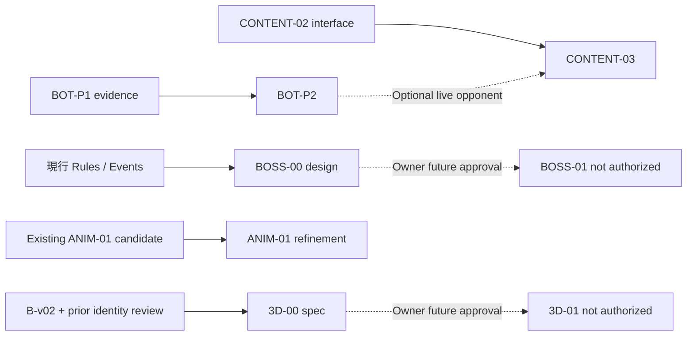

# TacticalGo｜五項工作 Master Contract

**版本**：Planning v1.0｜2026-10-11（Asia/Taipei）  
**工作性質**：交付 Codex 的設計／工程合約，**本次不執行工程修改**。

## 1. 使命、非目標與四層狀態

使命：保留已可玩的 7×7／9×9 核心，增加「有反制的策略選擇」與「角色表演品質」，同時阻止未核准的紅龍規則和失真 3D 模型進入正式路線。

- **規劃核准**：本包五個 Slice 都核准進入細部規劃。
- **工程候選**：程式／素材實作與測試通過，只表示候選可供 Owner 測試。
- **Owner-accepted validation debt**：Owner 明確允許某項未完成的驗證延後，附條件與負責人；不等於該驗證已 PASS。
- **正式採納／發布**：需要另外明確決策；工程測試、模擬器影片、PR 與真機安裝都不自動代表採納。

本輪禁止：寫入 repo、提交、push、merge、發版、改正式 Core 規則、偷偷啟用 R3、補新英雄、加第二技能、做 BOSS-01、開始完整 3D 建模／骨架、購買或使用未審權利素材。將來某片若另外獲得開發授權，仍不得自動擴大到上述其他片或發布。

## 2. 實際已確認的起點

| 項目 | 已確認／待確認事項 |
|---|---|
| GitHub `main` | 2026-10-11 查詢為 `cdab133cd469dd185fd8ca3f47fea2e217cfb139`；與本機最新工作樹可能不同 |
| 規則 | 每回合 2 AP、先手首回合 1 AP；行動／召喚／技能每次 1 AP；每回合最多一次技能；主將被提即敗；英雄被提不可重召；Core 原子結算與 Ko 不可破壞 |
| BOT-P1 | [PR #5](https://github.com/Gavin0099/TacticalGo/pull/5)：診斷層追蹤及兩手斬首反例；第 40 回合 Pass 有防守見證，第 55 回合仍不宜草率診斷 |
| CONTENT-02 | [PR #6](https://github.com/Gavin0099/TacticalGo/pull/6)：六關原版戰術挑戰、選關、提示、驗證、復原與獨立存檔；玩家回饋是六關太直覺 |
| R3 | opt-in 候選：戰士沿施放前相連棋群築壘、法師調度己兵到原群邊界；原版仍為預設，未做正式平衡認定 |
| 動畫 | 本機已交付法師「魔法之手」動畫候選（使用者提供）；Codex 要先查其原始資源、事件接線、影片與驗證報告，不要重新命名覆蓋 |
| 3D | 戰士 head-v02 的技術研究保留，但角色身份驗收未通過；目前採 A0 B-v02 原畫＋A Token＋2.5D 棋盤，3D 只允許規格研究 |
| UI | SELL-01C 最新候選與本機修整不保證在 `main`；任何 Gameplay／動畫分支要避免覆寫該線 UI |

**先讀文件**：`AGENTS.md` 與其有效基底、`docs/DECISIONS.md`、`docs/RULES_DRAFT.md`、`ios/README.md`、`docs/ios/V2_ASSET_CONTRACT.md`、`docs/ios/CHARACTER_PRODUCTION_ROUTES.md`；各片再依合約加讀專屬文檔。

## 3. 依賴矩陣

| Slice | 硬依賴（缺失即 HOLD） | 軟依賴／可並行 | 不得偷渡的後續工作 |
|---|---|---|---|
| BOT-P2 | 可重播的 BOT-P1 證據；正確 Core、測試基準；Owner 指定實作基線 | CONTENT-03 可先設計 | 強迫落子、規則變動、無證據調整難度 |
| CONTENT-03 | 可使用的 CONTENT-02 挑戰進入／存檔合約，或 Owner 同意先交資料與 fixtures | BOT-P2 若需要一般電腦動態反制 | 修改舊六關、擅自啟用 R3、加新技能 |
| BOSS-00 | 現行規則／事件／Ko／重播合約 | BOT-P2、CONTENT-03、3D-00 | BOSS-01 規則實作、紅龍模型、隨機開局上線 |
| ANIM-01 | 現有法師動畫候選／原 B-v02 素材／事件播放介面可檢查 | 3D-00 不必完成，與 BOT-P2 邏輯隔離 | 建模、改 Core、變更音樂、加入英雄語音 |
| 3D-00 | B-v02 原畫與可追溯來源；既有建模失敗與決策文件 | ANIM-01 可同步 | 新模型、頭雕、骨架、USDZ、App 接線 |

簡化依賴圖：



**重要整合衝突**：PR #5 和 #6 都源自 `cdab133` 且涉及 `memory/**`。未獲授權不得為了「方便」先合併或 rebase；未來由 Owner 決定合併順序，Codex 需保留兩邊獨立證據與規範化記憶紀錄，不能丟掉其中一側的記錄。

## 4. 每個 Slice 實作前的 Preflight Gate（本包只要求準備，非已完成）

1. 以唯讀方式記錄 `git status --short`、`git rev-parse HEAD`、工作樹路徑、遠端 PR Head、未提交差異與產物 SHA。**不要**因 dirty tree 而自動 reset、stash、清理、checkout。
2. 讀有效 `AGENTS.md` 與框架規範，列出限制；檢查被要求工作的本機候選是否可存取，缺失就列 `MISSING_INPUT`，不冒用另一分支或舊素材。
3. 判定實作基線：有些功能在 PR #5/#6，部分候選在本機。採用哪一個基線需可追溯；若無法安全判定，先 `BLOCKED`，不得改 main。
4. 先取得既有 Golden、Swift package、原生測試的 baseline receipt；新 Slice 只改自身允許路徑，必要共用路徑提出整合方案供審查。
5. 形成 `PLAN.md`、變更／風險清單、fixture 清單、回退策略與 Owner 驗收表，再開始任何另行授權的實作。

## 5. 共同工程原則（僅對未來獲得實作授權的 Slice 生效）

- **Core 唯一真相**：預覽不 commit，只有成功 action 的 Core outcome/events 能觸發正式盤面、資源與播放；UI、動畫、Bot 不另寫氣、提子、自殺、Ko 判定。
- **規則原版保護**：`original` 仍是預設，R3 必須 opt-in 且另存副本；任何新規則要有獨立 profile、Golden、存局／棋譜版本與退出路線，未核准不替換正式。
- **可重播與無隨機 side-effect**：同一完整 state、設定、種子與行動序列必須有同一結果；Bot、內容與動畫不能使用時鐘作為規則決策。
- **異常與取消**：undo、restart、離開、背景、延遲 Bot 結果、Reduced Motion、壞存檔，均須不造成第二次提交或幽靈棋子。
- **隔離交付**：各片各自測試、紀錄來源、保留明確版次，不讓 SELL-01C UI 或其他美術工作被意外覆蓋；不以便於整合為由跨片重構。
- **測試收據**：命令、commit/source SHA、環境、PASS/FAIL 數量、影片型別（模擬器／真機、音效是否後製）需如實記錄。不得沿用修改前過期收據。

## 6. 共用測試矩陣

| 變更類型 | 必要回歸（實作時） | 加值／真人驗收 |
|---|---|---|
| Bot 評分／搜尋 | Swift Bot/Package、可重播 40/55、立即勝負／救援／非法避免／預算不足、整局比較、Golden | 真機每回合節奏、玩家是否能預測與反制 |
| Challenge Controller／資料 | Core 合法性、固定分支、提示與失敗、save/undo/Ko、原六關與 38 組 Golden、原生 SE/iPad | 至少一次不看提示的 Owner 試玩；能說出失敗決策的原因 |
| 新環境規則 | **BOSS-00 僅做手算 trace／規則一致性論證，不執行程式** | 由 Owner 判定勝負與中立效果優先順序，才可立 BOSS-01 |
| 動畫 | Core events 不變／只成功播一次、預覽取消、Reduce Motion、背景與 undo、SE/iPad 兩種方向影片 | 身份、抬手／揮杖、打擊感與聲畫同步，需 Owner 看實際畫面 |
| 3D 設計規格 | **3D-00 文件與 reference 稽核，不製作模型或執行 App build** | 原畫身份特徵表、未定正側背假設及下一步 stop gate 由 Owner 核准 |

共用參考命令（以現有 checkout 與可用 toolchain 為準，**不是本次已執行**）：

```bash
swift test --package-path swift/TacticalGoCore
python3 scripts/verify-ios-parity.py  # 依環境另指定 TACTICALGO_DOTNET；先核對腳本需求
xcodebuild -project ios/TacticalGo.xcodeproj -scheme TacticalGo \
  -destination 'platform=iOS Simulator,name=iPhone 17' \
  CODE_SIGNING_ALLOWED=NO test
```

Golden 既有基線：38 組／99 步／137 snapshot（不同分支上的數字需重新確認）；測試數字只可作歷史資訊，**不能預先填成新片 PASS**。

## 7. 整合與決策關卡

- `G0-BASELINE`: 基準、PR、工作樹來源、既有候選與權限核對；不確定則 `BLOCKED`。
- `G1-DESIGN`: 有範圍、非目標、具體失敗情境、觀測指標與回退方案；由 Owner 決定是否實作。
- `G2-ENGINEERING`: 實作候選在隔離環境測試，回歸與證據可重現；PASS 只對工程有效。
- `G3-PLAYTEST/ART`: Owner 以真人對局、實機動作或原畫對照決定 `GO / REVISE / HOLD`。
- `G4-ADOPTION`: 另外核准合併、正式預設、真機安裝或發布；任何一項都不是 G3 自動結果。

**每階段停止條件**：不可證明是新能力而非規則錯誤、Bot 只能靠非法簡化改善、三關仍只靠直覺一步完成、龍息沒有可預告反制、法師身份在動畫中變形、3D 頭部仍不像原角色、Core／Golden 被無關動作修改、存局／可復原性下降。觸發後產出 HOLD 報告，不用大量新功能掩蓋。

## 8. 安全回退與交付版控

- 不動既有正式存局，不清除／重置進度、不覆寫目前候選圖片與報告。
- 每片的文件／fixture／影片／程式應能清楚指出原始基線與目標 SHA；程式實作若未獲授權，不得把資料包當 PR 直接推送。
- 影片與影像產物標示：原生擷取、後製、模擬器或真機，不能互換。
- 只有 Owner 明確同意，才可處理相依 PR 的 merge/rebase、替換預設技能、實機安裝、3D 素材升格與 App 發布。

## 9. 參考與追溯

- [現行 main commit](https://github.com/Gavin0099/TacticalGo/commit/cdab133cd469dd185fd8ca3f47fea2e217cfb139)
- [規則草案](https://github.com/Gavin0099/TacticalGo/blob/main/docs/RULES_DRAFT.md)
- [Owner 決策](https://github.com/Gavin0099/TacticalGo/blob/main/docs/DECISIONS.md)
- [BOT-P1 PR #5](https://github.com/Gavin0099/TacticalGo/pull/5)
- [CONTENT-02 PR #6](https://github.com/Gavin0099/TacticalGo/pull/6)
- [素材介面](https://github.com/Gavin0099/TacticalGo/blob/main/docs/ios/V2_ASSET_CONTRACT.md)
- [角色製作路線](https://github.com/Gavin0099/TacticalGo/blob/main/docs/ios/CHARACTER_PRODUCTION_ROUTES.md)
